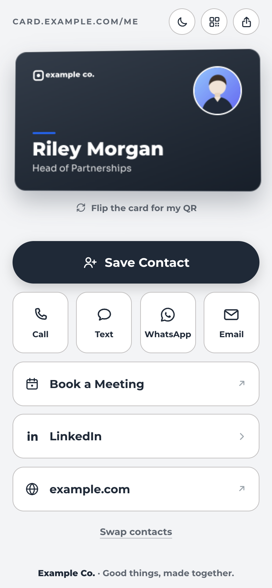
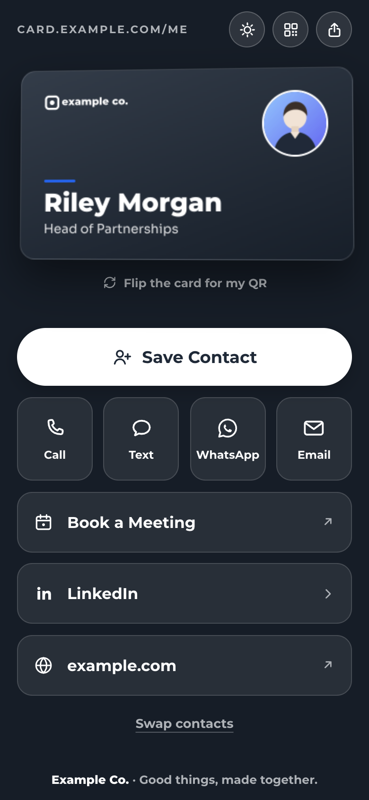
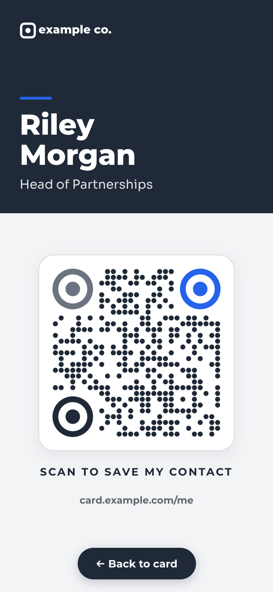
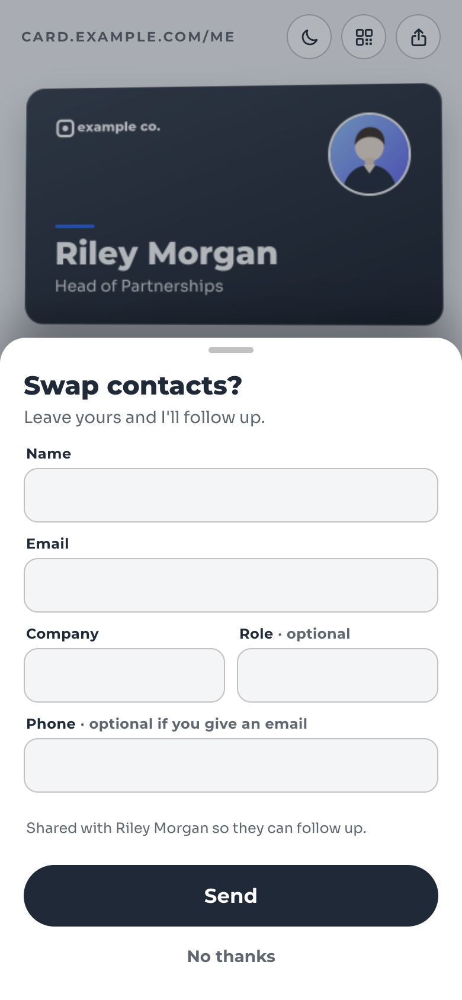
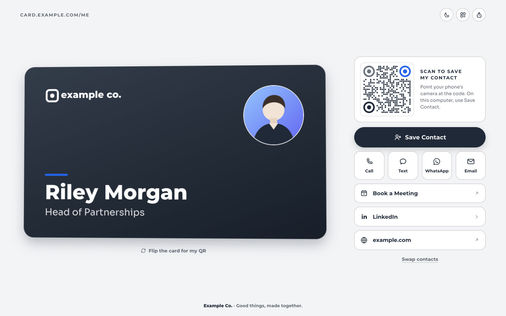
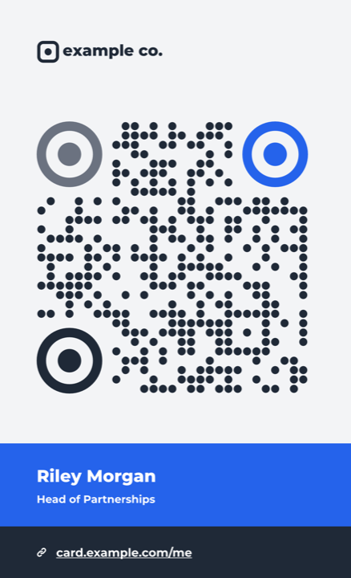
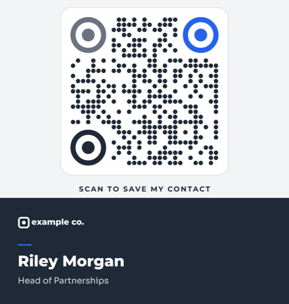

# edge-vcard

A digital business card that runs on a single Cloudflare Worker, on your own domain, on the free tier. People scan your QR code or open your link, tap **Save Contact**, and your details (with photo) land in their phone's contacts. No app, no account, no tracking cookies.

<table>
  <tr>
    <td></td>
    <td></td>
    <td></td>
    <td></td>
  </tr>
  <tr>
    <td align="center">Phone, light</td>
    <td align="center">Phone, dark</td>
    <td align="center">QR view</td>
    <td align="center">Swap contacts</td>
  </tr>
</table>



The person in the screenshots, Riley Morgan of Example Co., is fictional. Everything you see comes from [`card.example.json`](card.example.json).

## What it does

- **The card page.** Your card as an object that flips to its QR code, a big Save Contact button, quick actions (Call, Text, WhatsApp, Email) and link rows, low on the screen where the thumb is. Light and dark mode with a switch that is remembered on each device. On large screens the card sits on the left with a "Scan to save" QR panel on the right.
- **Save Contact.** A vCard 3.0 file (the version iOS and Android Contacts both import reliably) with your photo embedded, name, title, company, phone, email, website, LinkedIn, booking link and a link back to the card.
- **An installable QR view** at `/me/qr`: one phone screen with your name and a large QR code, for showing to someone across a table. Add it to your Home Screen and it opens offline, through a service worker.
- **Events.** A link such as `/me?e=summit` adds a note ("Met at Example Summit 2027, Lisbon") to the contact people save, and pre-fills the Text, WhatsApp and Email buttons with a message, but only between the dates you set. Before and after, the same link and printed QR behave like the plain card.
- **Swap contacts.** An optional form where a visitor leaves their own name, email or phone, company and role. Stored in a Cloudflare D1 database. Protected against spam by a hidden field, a minimum fill time and a per-hour cap, with no CAPTCHA.
- **Measurement.** Optional counts of views, saves and button taps in D1. No cookies, no IP addresses, no user agents stored.
- **A QR generator** for print and phones (`npm run qr`): the same styled code as on the card (round dots, ring finders in three colours), plus a vertical print card, iPhone Photos-widget images and a Lock Screen wallpaper.

Everything is configured in one JSON file. The look (colours, fonts, logo, background images) is a `theme` block in the same file.

## Quick start

You need [Node.js](https://nodejs.org/) 22 or later and a free [Cloudflare account](https://dash.cloudflare.com/sign-up).

```bash
git clone https://github.com/<you>/edge-vcard.git
cd edge-vcard
npm install
npm run setup
```

`npm run setup` copies `card.example.json` to `card.json` and `wrangler.example.jsonc` to `wrangler.jsonc`. Both copies are in `.gitignore`, so your own details and Cloudflare ids never end up in a commit.

1. **Edit `card.json`** with your details (see [Configuration](#configuration)), and put your photo in `public/assets/` (`photo.jpg`, about 480 px square, and `vcard-photo.jpg`, 240 px, which goes inside the vCard).

2. **Log in and create the database** (skip this step if you want neither counts nor the Swap form, and delete the `d1_databases` block from `wrangler.jsonc`):

   ```bash
   npx wrangler login
   npx wrangler d1 create edge-vcard
   ```

   Paste the `database_id` it prints into `wrangler.jsonc`, then create the tables:

   ```bash
   npx wrangler d1 migrations apply edge-vcard --remote
   ```

3. **Try it locally:**

   ```bash
   npx wrangler d1 migrations apply edge-vcard --local
   npm run dev
   ```

   Open http://localhost:8787/me.

4. **Deploy:**

   ```bash
   npm run deploy
   ```

   The card is live at `https://edge-vcard.<your-subdomain>.workers.dev/me`.

5. **Your own domain** (optional). With the domain's DNS on Cloudflare, uncomment `routes` in `wrangler.jsonc`, for example `{ "pattern": "example.com/me*", "zone_name": "example.com" }`, set `workers_dev` to `false` if you like, set `canonical` in `card.json` to `https://example.com/me`, and deploy again. If another site already lives on that hostname, set `PASS_THROUGH` to `"true"`: the route `/me*` also catches paths such as `/media`, and these then go to your site untouched.

   To serve the card at the root of its own hostname (say `card.example.com/`), set `BASE_PATH` to `""` and use a custom domain or the route `card.example.com/*`.

Everything here fits Cloudflare's free plan: Workers (100,000 requests a day), Static Assets, D1 and KV.

## Configuration

`card.json` holds all the content. The fields:

| Field | What it is |
|---|---|
| `canonical` | The card's public URL (`https://…`). The QR codes encode it. |
| `name`, `givenName`, `familyName` | Full name, and its parts for the vCard and the QR view. |
| `title`, `company`, `tagline` | Shown on the card; `tagline` in the footer. All optional. |
| `lang` | The page language (default `en`). |
| `images.photo` | Photo on the card, the zoomed view and link previews (a file in `public/assets/`). |
| `images.vcardPhoto` | The photo inside the vCard. JPEG (or PNG), keep it small: 240 px is plenty. |
| `images.appIcon`, `images.share` | Home Screen icon of the QR view, and the link-preview image. Both default to the photo. |
| `contact` | `email`, `phone`, `whatsapp`, `website`, `linkedin`, `booking`. These feed the vCard; leave out any you don't use. |
| `vcard.includeWhatsapp` | `true` adds `contact.whatsapp` as a second number labelled WhatsApp (when it differs from `phone`). |
| `vcard.labels` | Override the labels of the vCard's links, e.g. `{ "booking": "Schedule a call" }`. |
| `links` | The buttons, in order. `label`, `href`, `icon` (`phone`, `message`, `whatsapp`, `mail`, `calendar`, `linkedin`, `globe`), `"group": "quick"` for the row of four square buttons, `newTab: true` to open in a new tab. |
| `swap` | `enabled` shows the Swap contacts link and form; `subtitle` and `consent` change its text (`{name}` becomes your name). |
| `qr.appTitle` | The name under the Home Screen icon of the QR view (default "My QR"). |
| `events` | See [Events](#events). |

### Theme

The `theme` block sets the look. Every key is optional; the defaults give the neutral graphite-and-blue look in the screenshots.

```json
"theme": {
  "mode": "light",
  "brand": "#1f2937",
  "accent": "#2563eb",
  "light": "#f3f4f6",
  "dark": null,
  "logo": "logo-white.svg",
  "backgrounds": { "dark": null, "light": null },
  "fonts": {
    "heading": { "family": "Montserrat", "files": { "700": "fonts/Montserrat-Bold.woff2", "800": "fonts/Montserrat-ExtraBold.woff2" } },
    "body": { "family": "Sora", "files": { "400": "fonts/Sora-Regular.woff2" } }
  },
  "qr": { "dot": "#1f2937", "finders": ["#6b7280", "#2563eb", "#1f2937"] }
}
```

- `mode`: how the page starts for a first-time visitor: `light`, `dark` or `system` (the device's own setting). The sun/moon switch overrides it on that device.
- `brand`: the card front, the dark page, the primary button and the QR view's header. Pick a dark colour: text on it is white.
- `accent`: the small rule on the card and the focus rings.
- `light`: the light page and the QR side of the card. `dark`: the dark page; unset, it is the brand colour made a little darker so the card stands out.
- `logo`: a logo in white (it sits on the brand colour), as a file in `public/assets/`. Without one, the company name is shown in text.
- `backgrounds`: optional images behind the dark and light page.
- `fonts`: any web font you put in `public/assets/`, by weight. The heading font is used at weights 700 and 800, the body font at 400.
- `qr`: the colour of the dots and of the three finder rings (top-left, top-right, bottom-left). Unset, they follow `brand` and `accent`.

The Worker serves the theme as `/me/assets/theme.css`. Colours must be hex values and file names plain names inside `public/assets/`; anything else is ignored and the default used, so a mistyped value cannot break the page or inject styles.

### Worker settings

In `wrangler.jsonc`, under `vars`:

- `BASE_PATH`: where the card lives, `/me` by default. `""` serves it at the root of the hostname.
- `PASS_THROUGH`: `"true"` sends requests that match the route but fall outside `BASE_PATH` to the site behind the route. Otherwise they are redirected to the card.

Bindings, all optional: `STATS` (D1, for counts and the Swap form), `CARD` (KV, see below).

### Card data in KV (optional)

If you bind a KV namespace as `CARD` and write a card under the key `card`, the Worker serves that instead of the bundled `card.json`, so a separate admin tool can change the card without a deploy. The bundled file stays as the fallback whenever the key is missing, not valid JSON or lacks a required field. KV is read through the edge cache for a minute. Extra images can be stored in the same namespace as `asset:<name>` (svg, png, jpg, webp); a KV file never replaces a bundled one.

## Events

An event is an entry under `events`, keyed by its code:

```json
"events": {
  "summit": {
    "label": "Example Summit 2027",
    "note": "Met at Example Summit 2027, Lisbon (Mar 2027).",
    "from": "2027-03-08",
    "until": "2027-03-21",
    "timeZone": "Europe/Lisbon",
    "default": false,
    "swapMessage": "Hi Riley, we met at Example Summit 2027. This is ",
    "emailSubject": "We met at Example Summit 2027",
    "emailBody": "Hi Riley,\n\nWe met at Example Summit 2027 in Lisbon. This is "
  }
}
```

- **The date window.** `from` and `until` are inclusive and read in the event's `timeZone`. Either can be left out. Outside the window the code is ignored: the link works, the note just stops. Contacts already saved keep their note.
- **`?e=summit`** in a link (or in the QR on your phone) turns the event on for that visit: the note goes into the vCard, and the card's QR shows the event's link, so someone who scans your phone gets the note too.
- **`"default": true`** makes the plain card act as the event inside its window. Use it for printed material that carries no code. An explicit `?e=` always wins.
- **Pre-filled messages.** With `swapMessage`, the Text and WhatsApp buttons open with that message written; ending it with "This is " leaves the cursor where the visitor types their name. With `emailSubject` and `emailBody`, Email opens a new message with them.
- Codes are only ever looked up in the card data, so nothing typed into a URL reaches the page or the vCard as text. An unknown code is ignored. Each event gets its own QR at `/me/assets/qr-<code>.svg`, drawn by the Worker; an unknown code there gets a 404.
- To check a window, give an event today's dates, run `npm run dev` and open `/me/contact.vcf?e=<code>`.

## Swap contacts and measurement

Both need the D1 database (`STATS`). Without it the card works the same, minus the counts and the form.

**Swap contacts.** A quiet "Swap contacts" link under the buttons opens a short form: name, email, company, role and phone, with real labels and `autocomplete` tokens so iOS offers AutoFill Contact and Android its autofill. Required: a name plus an email or a phone. Each send is one row in the `leads` table: the time, the event, the five fields and the visitor's country. Nothing else. Spam guards:

- a hidden field people never see (bots fill it in);
- at least 2.5 seconds between opening the form and sending it;
- same-origin requests only, at most 4 KB;
- at most 30 sends per hour for the whole card.

A caught bot gets the same "ok" a person does, so it learns nothing. Rows older than 12 months are deleted by the Worker now and then. There is no email notification; read the contacts with wrangler:

```bash
npx wrangler d1 execute edge-vcard --remote --command "SELECT created_at, event, name, email, phone, company, role FROM leads ORDER BY id DESC"
```

Names are stored exactly as typed. Anything that displays them must escape them, and a spreadsheet export should neutralise cells that start with `=`, `+`, `-` or `@`.

**Measurement.** One row in the `hits` table per card view, contact save and button tap: the day, the event and whether it came from a code or the date window, a `?s=` source tag if the link carried one (e.g. `?s=nfc` on an NFC tag), the country, phone or desktop, and the in-app browser (LinkedIn, Instagram…) if any. No cookies, no IP address, no user agent. Link-preview fetchers (WhatsApp, Slack, iMessage…) and scripts are stored as `preview`, not as views, and browser prefetches are not stored. Rows older than 13 months are deleted now and then.

```bash
# Views, saves and taps per event
npx wrangler d1 execute edge-vcard --remote --command "SELECT event, via, kind, count(*) AS n FROM hits WHERE kind != 'preview' GROUP BY 1,2,3"

# Which buttons people tap
npx wrangler d1 execute edge-vcard --remote --command "SELECT target, count(*) AS n FROM hits WHERE kind = 'tap' GROUP BY 1 ORDER BY 2 DESC"
```

## The QR generator

`npm run qr` makes print and phone files with the same styled code the card shows. Point it at your card file to pick up the link, name, title, colours and logo:

```bash
npm run qr -- --config card.json --logo examples/logo.svg --out out --prefix me --widgets yes --wallpaper yes
```

<table>
  <tr>
    <td></td>
    <td></td>
  </tr>
</table>

It writes, for `--prefix me` in `--out out`:

- `me-qr.svg` and `me-qr-2000px.png`: the code alone (`--bg`, `--pad` for the quiet zone in modules, `--qr-px` for the PNG width);
- `me-card.svg` and `me-card.png`: a vertical card with your logo (`--logo`, an SVG or PNG for a light ground), the code, a name band and a link band (skip with `--qr-only yes`);
- with `--widgets yes`: `me-widget-medium.png` and `me-widget-large.png`, sized for the iPhone Photos widget so they show uncropped;
- with `--wallpaper yes`: `me-wallpaper.png`, a 1290 × 2796 Lock Screen wallpaper with the top third left free for the clock.

Colours come from the card's theme, and each can be set on the command line: `--dot`, `--finders "#a,#b,#c"`, `--brand`, `--band`, `--accent`, `--light`. `--url` encodes anything else, for example an event link: `--url "https://example.com/me?e=summit"`. `--ecc` sets the error correction (default `Q`: the round dots cover less of each module than squares, so the extra redundancy keeps the code readable). Run `npm run qr -- --help` for the full list.

**Check every file before printing.** A styled code must still scan: open it on a screen and scan it with two different phones, also from a distance and at the size you will print it. The tests decode every layout with [ZXing](https://github.com/zxing-cpp/zxing-cpp), but a print shop's colours and paper are another matter.

On your phone: AirDrop the widget image, put it in a Photos album of its own and point a Photos widget at that album. For the QR view, open `/me/qr` in Safari and choose Share → Add to Home Screen; open it once with a connection after each deploy so the offline copy stays fresh.

## Security and privacy

- A strict Content Security Policy: scripts and styles only from the card's own origin, no inline scripts, no forms posting elsewhere, no framing. Cloudflare Web Analytics is allowed in the policy; remove its two hosts in `src/app.js` if you do not use it.
- Every value from the card data is HTML-escaped; theme values are validated before they reach CSS; event codes are only looked up, never echoed.
- Pages are served with `noindex`, so your phone number is not pushed into search results.
- No cookies. The only thing stored in the visitor's browser is their light/dark choice.
- SVG files are served with a sandboxing policy, so one opened on its own runs nothing.

See [SECURITY.md](SECURITY.md) to report a vulnerability.

## Development

```bash
npm test          # vCard, events, QR (generation and decoding), the Worker's routes and the Swap form
npm run dev       # the Worker locally at http://localhost:8787/me
```

There is no build step and no framework: the Worker is plain JavaScript modules that wrangler bundles, and the page is server-rendered HTML with two small scripts.

```
src/
  index.js       entry point: bundles card.json
  app.js         routes, assets, KV, measurement, Swap endpoint, service worker
  render.js      the card page, the Swap sheet and the QR view
  vcard.js       vCard 3.0 builder (escaping, 75-octet folding, photo)
  events.js      event codes and date windows
  swap.js        Swap form validation
  theme.js       theme defaults, validation and theme.css
  qr.js          styled QR codes (shared with the generator)
public/assets/   card.css, card.js, theme.js, qr.js, images and fonts
migrations/      D1 tables
tools/qr/        the QR generator and its fonts
test/            node:test suites
examples/        the example persona's logo (for print) and avatar source
```

Contributions are welcome: see [CONTRIBUTING.md](CONTRIBUTING.md).

## Roadmap

An admin panel (contacts, numbers, events and their QR files, card settings) and a companion web app for capturing contacts at events are next. See [ROADMAP.md](ROADMAP.md).

## Licence

[MIT](LICENSE). The bundled fonts, Montserrat and Sora, are under the SIL Open Font License 1.1; their licence files are next to them in `public/assets/fonts/` and `tools/qr/fonts/`.
